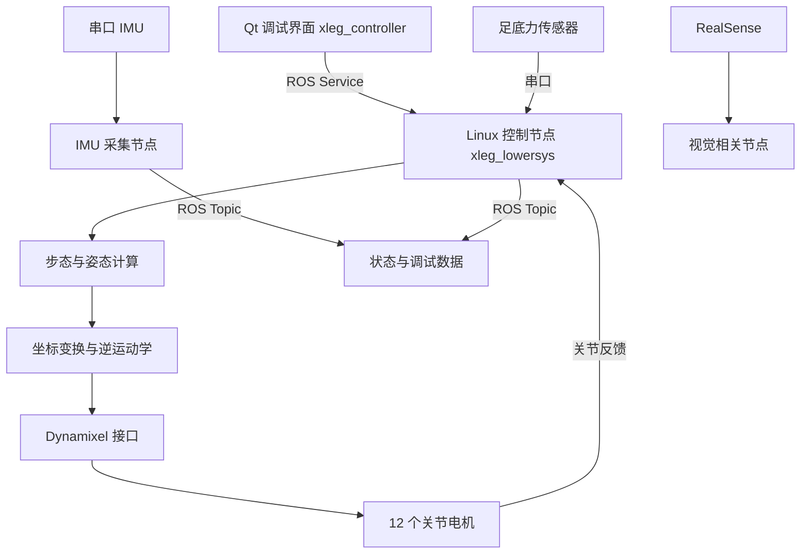
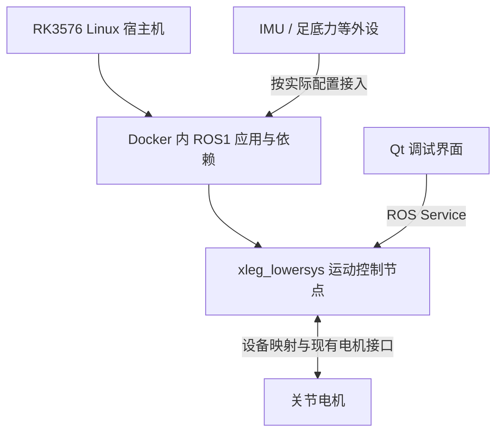

# 基于 Linux 与 ROS1 的多地形移动攀爬机器人

面向坡面、崎岖地形与攀爬场景的四足机器人软件工程，围绕关节控制、步态生成、姿态调整、足底接触感知及视觉接入，构建从操作指令到电机执行的软件链路。

当前仓库以 **ROS + C++ + Qt + Dynamixel** 为基础，包含四足运动控制、上位机调试、IMU 和足底力采集、RealSense 视觉相关代码。**已通过 Docker 将现有 ROS 代码部署到 RK3576，并完成板端运行及效果验证。** 后续重点整理实际部署配置和实机演示资料。

> **项目状态：RK3576 Docker 部署与运行已完成，公开资料整理中。** 板端成果由项目作者确认，实际镜像、启动配置和视频将陆续补充。

## 演示视频

[观看 RK3576 板端运行演示](./演示视频.mp4)

## 项目背景与目标

非结构化地形下，四足机器人需要协调足端轨迹、机身姿态与支撑关系，同时处理设备通信、传感器反馈及异常停止。本项目以现有四足平台为基础，已通过 Docker 完成现有代码在 RK3576 上的部署和运行，当前重点完善项目展示与复现资料。

建设目标包括：

- 以明确的腿号、关节映射及坐标系完成四足运动控制。
- 通过 Qt 上位机进行电机、姿态与步态调试。
- 接入关节反馈、IMU、足底力和视觉信息，为状态估计提供输入。
- 使用 Docker 承载现有 ROS1 应用，完成 RK3576 板端部署与运行。
- 整理已运行成功的镜像、设备映射、网络配置与启动流程，上传实机视频。

## 当前代码能力

| 模块 | 仓库内容 | 当前边界 |
|---|---|---|
| 上位机 | Qt 控制界面、电机与运动参数调试入口 | 位于 `xleg_controller` |
| 运动控制 | 四足步态、机身姿态调整、坐标变换和逆运动学 | 位于 `xleg_lowersys`，仍需逐项记录实机验证 |
| 电机控制 | Dynamixel 使能、目标位置、速度参数与反馈相关逻辑 | 当前由 Linux 节点访问电机 |
| 足底力 | 串口采集、足底力发布与接触判断相关逻辑 | 依赖匹配的采集硬件与协议 |
| IMU | 串口协议解析与 ROS 数据发布 | 独立 IMU 包与控制包中均有相关代码，接入时避免重复访问设备 |
| 视觉 | RealSense 接入、图像处理与位置获取相关代码 | 不代表已实现 MIPI/ISP 或完整自主导航 |
| ROS 接口 | 自定义消息、姿态/步态/舵机控制 Service | 使用 ROS1/catkin |
| 部署资料 | 板卡运行说明、运动执行流程与关节方向验证 | 部分为历史环境记录，需按实际设备调整 |

当前运动控制入口包含全方位 3+1、对角步态及相关调试选项；具体适用地形与稳定性以实机测试为准。项目名称描述研究与建设方向，不表示已完成任意地形自主攀爬。

## 系统架构

### 当前实现



`xleg_lowersys` 为 Linux 上运行的 ROS 控制节点，通过现有接口访问电机。

### RK3576 Docker 部署结构



宿主机提供系统、硬件驱动和设备节点；容器承载 ROS1、应用及依赖。Qt 所在机器和实际启用的传感器以成功部署配置为准。

## 技术栈

| 类别 | 技术与内容 |
|---|---|
| 运行平台 | RK3576、Linux、Docker |
| 软件与构建 | C++、CMake、catkin |
| 通信 | ROS1、Topic、Service、自定义消息 |
| 界面与执行器 | Qt、Dynamixel SDK / Workbench |
| 感知相关代码 | 串口 IMU、足底力、RealSense、OpenCV |

## 仓库结构

```text
.
├── README.md
├── DOCKER_DEPLOYMENT.md
├── 演示视频.mp4
├── Dockerfile
├── docker-compose.yml
├── install_libraries.sh
├── run.sh
└── qs_robot/                   ROS1 软件包
    ├── xleg_controller/        Qt 上位机
    ├── xleg_lowersys/          运动控制与设备接入
    ├── xleg_msgs/              消息与服务
    ├── miiboo_imu/             串口 IMU
    ├── vision_process/         视觉处理
    └── realsense-ros-2.1.0/    RealSense ROS 包
```

## 编译与运行

RK3576 板端采用 Docker 运行现有 ROS1 工程。镜像准备、容器启动、工作空间构建和 ROS 网络配置见 [Docker 部署方案](DOCKER_DEPLOYMENT.md)。以下 ROS 命令在加载对应工作空间环境后使用。

### 1. 检查设备

```bash
ls -l /dev/dxl_port /dev/force_port /dev/imu_port
```

现有控制代码使用这些串口别名。请按实际 USB 设备配置 udev 与用户权限，避免串口枚举顺序变化导致设备错配。

独立 IMU 启动文件当前默认使用 `/dev/imu`，与控制代码中的 `/dev/imu_port` 不同，运行前必须统一。独立 IMU 节点与控制节点不要同时占用同一个串口。

### 2. 启动控制节点

在已加载工作空间环境的终端执行：

```bash
roslaunch xleg_lowersys xleg_lowersys.launch
```

该 launch 会按需启动 ROS master，无需另外重复启动 roscore。

另开终端，加载 ROS 与工作空间环境后启动界面：

```bash
source devel/setup.bash
roslaunch xleg_controller xleg_controller.launch
```

也可按原有流程分别运行 `roscore`、`rosrun xleg_lowersys xleg_lowersys` 和 `rosrun xleg_controller xleg_robot`。

### 3. 独立传感器调试

确认没有其他进程占用 IMU 串口后：

```bash
roslaunch miiboo_imu imu.launch
```

已安装匹配 RealSense 依赖并连接相机时：

```bash
roslaunch realsense2_camera rs_camera.launch
```

### 4. 检查 ROS 接口

```bash
rosnode list
rostopic list
rosservice list
rostopic hz /xleg/jointState
rostopic echo /xleg/footForce
```

主要接口如下；表中为默认相对名称在无命名空间启动时的路径，运行时以实际 ROS 图为准。

| 接口 | 类型 | 用途 |
|---|---|---|
| `/xleg/servoControl` | Service | 电机使能、停止及相关控制 |
| `/xleg/bodyControl` | Service | 就绪、结束及机身姿态调整 |
| `/xleg/gaitControl` | Service | 步态与单次/连续运动 |
| `/xleg/motorCode` | Service | 电机调试 |
| `/xleg/dataSave` | Service | 数据保存控制 |
| `/xleg/jointState` | Topic | 关节状态 |
| `/xleg/footForce` | Topic | 足底力与相关状态 |
| `/xleg/bodyState` | Topic | 机身状态 |
| `/imu` | Topic | 独立 IMU 节点输出 |

## 基础调试流程

首次调试前核对电机 ID、关节方向、零位、机械限位和机器人坐标系。先进行架空、单关节和小幅运动验证，再进行低速平地运动。

1. 加载力矩。
2. 机器人就绪。
3. 检查初始姿态和反馈。
4. 选择 3+1 步态，使用小步长、较长周期。
5. 先执行“运动一次”，确认腿序与方向。
6. 通过后再测试连续运动。
7. 停止运动，再按当前支撑条件执行结束动作。

平地调试中的释放力矩操作不直接适用于坡面或攀爬工况，后续需要独立的支撑、吸附与故障策略。

## RK3576 Docker 部署成果

已通过 Docker 将现有 ROS1 代码部署到 RK3576，并完成运行及效果验证。当前重点是公开实际部署资料和演示视频。

| 内容 | 状态 |
|---|---|
| 现有代码部署到 RK3576 | 已完成 |
| Docker 运行与效果验证 | 已完成 |
| 实际镜像、环境版本和启动配置归档 | 待整理 |
| 实机演示视频 | 已收录 |

完成状态依据项目作者确认的板端结果；本次文档整理未重新进行硬件测试。后续优先保存已成功使用的命令，再按需要补充 Dockerfile 或 Compose。

## 资料完善安排

- [x] 通过 Docker 将现有 ROS1 工程部署到 RK3576。
- [x] 完成板端运行并实现效果。
- [x] 收录实机演示视频。
- [ ] 整理实际镜像、宿主系统和 ROS1 版本。
- [ ] 补充容器启动命令、设备映射与 ROS 网络配置。
- [x] 整理 Docker 部署方案。
- [ ] 按文档执行复现核查，记录常见问题。

## 验证与结果记录

RK3576 Docker 部署与运行已完成，演示视频已收录，后续补充对应运行记录。记录包括代码版本、系统与镜像、设备映射、操作步骤、运动参数、测试场地和已知问题。实际接入的传感器及展示动作以本次演示为准，性能数据以实测为准。

## 相关文档

- [Docker 部署方案](DOCKER_DEPLOYMENT.md)

## 许可与第三方组件

仓库当前未提供统一的根目录 LICENSE；原创代码的开源许可将在确认权属后补充。第三方 SDK、驱动与 ROS 包保留各自许可，不能将其视为统一采用某一种许可证。
